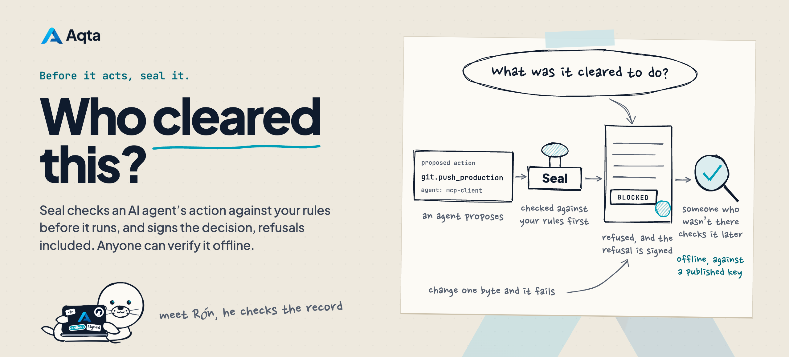

<div align="center">



**Controls for AI that hold when challenged.**

[aqta.ai](https://aqta.ai) · [Try to break a real record](https://app.aqta.ai) · [Verify one in your browser](https://app.aqta.ai/verify) · [The open spec](https://github.com/Aqta-ai/attestation-spec)

</div>

## Check a real record in 20 seconds

A real refusal from Seal's public demo, signed on 22 August 2026: an agent asked to push to production, and the rules said no. Verify it offline against Seal's published key:

```sh
curl -sO https://app.aqta.ai/samples/sample-action.json
npx aqta-verify-receipt --profile action-1 \
  --key 9Y3Eiq6V8QjRDUM5nPqSwKIOPQaoEU4SbagfYFdvWa4 sample-action.json
# ✓ valid  BLOCKED  05e9…e4942c  pinned issuer key, profile ACTION-v1
```

Now change `BLOCKED` to `ALLOWED` in the file and run it again. The signature fails.


## How Seal works

1. **Before the action.** An agent proposes an action. Seal checks it against your rules first, and can require a named approver's signed yes, bound to the exact values they approved.
2. **The record.** The decision is signed, allowed or refused, and enters a public, append-only log as a hash.
3. **When challenged.** Anyone can check the record offline against the published key. Change one byte and it fails.

## What's here

| Repository | What it is |
|---|---|
| [**attestation-spec**](https://github.com/Aqta-ai/attestation-spec) | The open record formats, ATTESTATION-v1 for model calls and ACTION-v1 for agent actions, with reference verifiers in TypeScript and Python, published as `aqta-verify-receipt` on npm and PyPI. |
| [**bounds**](https://github.com/Aqta-ai/bounds) | PDF redaction that runs entirely on your device. |
| [**aqtabio-research**](https://github.com/Aqta-ai/aqtabio-research) | Research on forecasting zoonotic spillover risk: methodology and validation cohort. |

<sub>Aqta Technologies Limited · Dublin, Ireland · [hello@aqta.ai](mailto:hello@aqta.ai)</sub>
